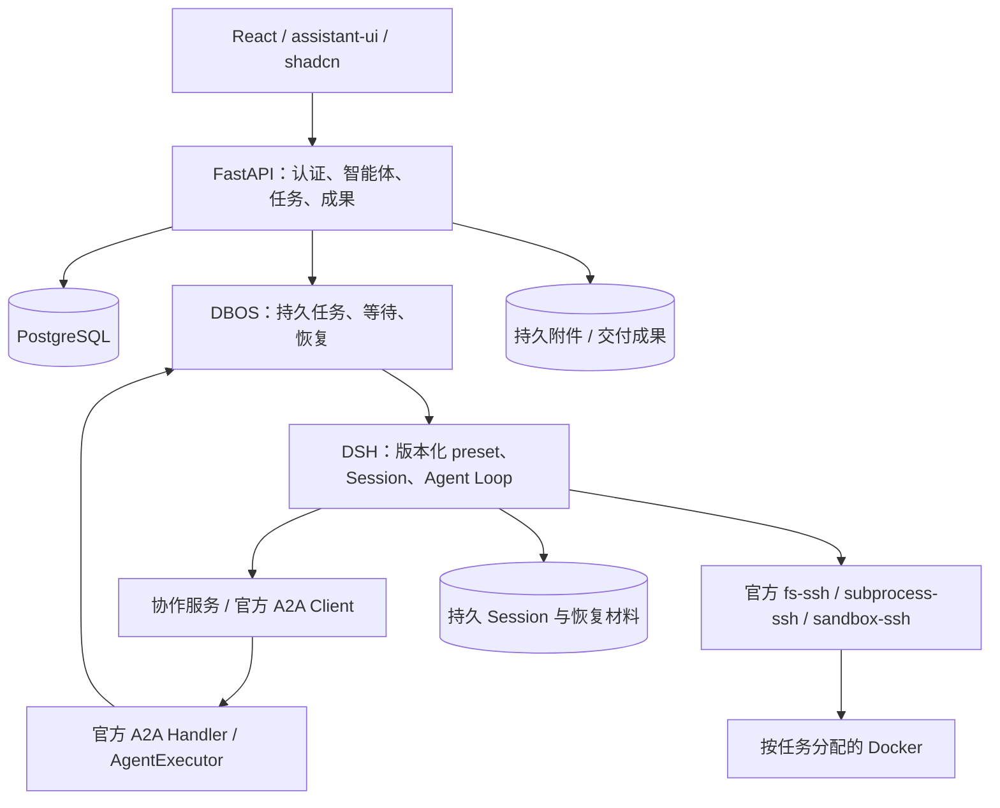

# 智能体平台首版技术架构

状态更新（2026-10-27）：用户已授权正式迁移，核心实现和旧数据导入已完成，正在进行产品级验收。以下保留设计目标；实际完成项、证据与未完成门槛以[迁移验收报告](../development/platform-acceptance.md)为准。

## 1. 主要决定

1. 保留 React + FastAPI 同源部署、现有页面风格、账号认证与 DSH Agent Loop。产品中心改为智能体定义、任务、协作和成果；不再按用户维护长期执行环境。
2. 首版引入 **DBOS Python 持久执行 + PostgreSQL**，负责受理、等待和重启接管。DSH 负责模型循环、Session、inbox、工具与检查点。重启恢复是发布门槛，不是第二阶段功能。
3. 已发布智能体之间统一走 **官方 A2A Python SDK**；不自己实现协议、SQL TaskStore 或协议事件流。平台只补发现、授权、版本和任务映射。
4. 普通 Agent 使用明确裁剪的 DSH composition；需要代码时分配任务级 Docker，优先用官方 SSH 文件/进程/沙盒提供方连接。会话与模型凭据留在可信服务侧。
5. 保留 UI 组件和安全文件响应，替换用户 Host 池、物理目录导航和内存中的任务控制。旧账号、聊天、原文件引用保留；不把旧项目伪装成新智能体。

DBOS 的 workflow 是内部可靠执行机制，不提供用户预编排功能。暂不引入 Redis、Celery、Temporal Service、Kubernetes 或完整向量数据库。首版单执行实例；多机高可用另行设计，不把单机重启恢复称为高可用。

## 2. 部署与职责

这些是模块，不是各自一套微服务。首版 FastAPI lifespan 启停 DBOS；Node DSH 作为受控执行进程。服务管理器负责服务崩溃后拉起，DBOS 负责服务起来之后找回未完成工作。登录、广场、历史列表、成果下载只依赖数据库和存储，不启动 DSH 或 Docker。

### 状态归属

| 状态 | 唯一主要管理方 | 不承担的职责 |
| --- | --- | --- |
| 用户、草稿、发布版本、评论、记忆、知识归属 | 平台 SQLAlchemy 模型 | 不保存另一套 Agent Loop 状态 |
| 任务身份、用户/根/父关系、发布版本、输入与成果引用 | 平台任务模型 | 不自写抢占租约和轮询任务队列 |
| 可靠执行、步骤结果、等待消息、重启接管 | DBOS 官方存储 | 不恢复原 Shell 栈，不自动杀孤儿进程 |
| 模型消息、工具历史、inbox、内部子代理检查点 | DSH 官方 Session 存储 | 不等于发布版本管理、全平台自动调度 |
| A2A Task、版本化状态与协议事件 | 官方 VersionedDatabaseTaskStore / DatabaseTaskEventStream | 不替代执行恢复，也不作为私人记忆库 |
| 文件字节、成果清单、必要恢复材料 | 独立持久存储 + 平台元数据 | 不随沙盒回收删除 |

界面状态是上述事实的投影。不得通过“页面标记 completed”代替执行完成，也不把 token 增量当作已提交检查点。

## 3. 技术栈与复用边界

| 层 | 选择 | 说明 |
| --- | --- | --- |
| 页面 | 现有 React、Vite、TypeScript、Tailwind、shadcn、assistant-ui | 保留布局、可调整侧栏、对话、文件预览；不移植整套 DSH 桌面应用 |
| 前端状态与 API | TanStack Query、Zustand、现有 OpenAPI 生成链路 | Query 管服务数据，Zustand 管局部交互；新流适配集中处理 |
| API / 认证 | FastAPI、Pydantic、PyJWT、pwdlib | 保留 Bearer JWT 与密码散列；A2A 路由显式接认证上下文 |
| 元数据 | SQLAlchemy async、Alembic、PostgreSQL | 同一 database 分业务与 DBOS schema；延续当前不强制应用外键的决定 |
| 持久执行 | DBOS Python，候选 `3.3.0` | 使用公开队列、消息与事务入队；版本待接入实验后锁定 |
| 协作协议 | 官方 `a2a-sdk`，候选 `1.2.3` | 官方 FastAPI routes、Client、AgentExecutor、SQL 状态/事件存储 |
| Agent 内核 | DSH 现有锁定 `0.2.1-rc.3` | 官方 presets、Controller、检查点、Session 恢复；本轮不升级 |
| 代码执行 | Docker + DSH 官方 SSH provider 组件族 | 任务级申请与回收；平台只补供给、身份、挂载、成果收集 |
| 文件 | 首版受控本地持久目录 + 现有安全 FileResponse | 用 artifact ID，不依赖活着的容器；规模需要时再换对象存储 |
| 检索与记忆 | 首版 SQL + PostgreSQL 文本检索，结构化记忆 CRUD | 不先造向量库/知识图谱；中文召回和文档解析质量须单独验收 |
| 开发与验证 | 现有 uv/npm、Ruff/Pyright、ESLint/Prettier、pytest/Vitest | 继续用 Codex 内置浏览器验收；不新增 Playwright 依赖 |

候选版本是本次核查版本，不代表已安装、兼容性已验证或长期“最新版”。数据库、DBOS 与 A2A 的建表/升级交给各自公开迁移方式，平台 Alembic 不随意改第三方内部表。

官方依据及限制：[DBOS 研究](../research/durable-execution-options.md)、[A2A 研究](../research/a2a-platform-integration.md)、[沙盒研究](../research/task-sandbox-and-code-reuse.md)。文档解析须选成熟解析器并在隔离环境验证格式支持，首批以文本/Markdown/HTML 为基线，不把任意上传格式默认为已支持。

## 4. 智能体与任务模型

建议领域模块：`agents`、`tasks`、`collaboration`、`memory`、`knowledge`、`artifacts`、`runtime`，不是按每张表创建一个服务。

- **Agent / Draft / PublishedVersion**：可编辑草稿与不可变发布版本分离。创建助手也使用 DSH，通过平台可信工具访谈、更新草稿、试跑；只有用户确认动作能发布。作者或管理员编辑，不通过任意模型工具自动发布。
- **Conversation / TaskRun**：聊天是用户交互上下文；每次工作有独立 task ID。每项任务绑定使用者、原目标、Agent 版本、模型选择、DSH Session 与恢复输入。同一公开 Agent 的不同使用者不共用 Session。
- **Delegation**：记录 root/parent、目标版本、工作目的、输入、状态、结果引用以及 A2A 标识。公开 Agent 的定义无用户私有状态，运行实例有状态。
- **Artifact / RecoveryMaterial**：成果与恢复必需文件有稳定 ID、owner、来源 task、内容摘要和存储位置；scratch 可以删除，恢复材料在关联任务完成前不可回收。
- **Memory / KnowledgeRevision**：用户全局偏好、用户与 Agent 的专属记忆、作者明确共享知识分开。知识修订和发布版本绑定，任务输入固定所用修订，不能恢复时悄悄换资料。

`task_id` 用作稳定 DBOS workflow 身份；`attempt_id` 表示一次接管；A2A `taskId/contextId`、DSH `sessionId` 各保留原语义，通过表映射，不能都塞进 conversation ID。DSH preset ID 包含发布版本身份，重建时注册相同不可变定义及可信工具版本。

首版下架策略建议：停止新调用、保留历史版本供在途任务恢复；管理员紧急撤销则显式阻塞对应任务，不静默换版本。记忆关闭阻止后续读取和自动写入；删除移除记忆库内容，不声称已删除历史聊天中的原话。恢复先应用最新访问撤销，再使用仍获授权的保存输入。这些是提案中的默认语义，实施时需在界面说明。

## 5. 自主协作：统一 A2A 通道

调用路径：`DSH discover/start/wait 工具 → 协作服务 → 官方 A2A Client → 官方 Handler → 平台 AgentExecutor → DBOS → DSH`。所有已发布 Agent 的委派采用此路径；DSH 内部本地子代理可以用于单项执行内部工作，但不是另一条公开 Agent 调用通道。

DSH 当前未核查到官方 A2A 插件，因此发现/委派薄工具是必要业务适配。暂不同时引入 external subagent provider：它的一次执行接口不自动支持 A2A 后续输入与冷恢复。控制服务按公开接口桥接即可，不复制 DSH 子代理调度器。

A2A Handler 必须在短事务中持久受理，执行交给 DBOS，不能让原请求协程成为任务唯一载体。DBOS step 内不能直接创建新的 DBOS workflow；执行中的委派通过独立、幂等的协作受理入口提交。父级等待使用持久任务/消息；不能占满固定执行队列后让所有父任务一直等没有运行槽的子任务。并发槽只约束实际模型/工具工作，等待中的父级释放槽位，必须有饥饿测试。

- A2A `messageId` 与原 DSH tool-call 身份一起参与请求去重；服务端额外验证 owner 和参数摘要，不能假设协议自动保证幂等。
- “重试同一次调用”用稳定委派 ID 去重；“两次描述其实同一工作”由 Agent 查询根任务工作记录并显式选择复用。仅对文字做 hash 不能保证语义去重。
- 去重范围为同用户、同根任务；同一 Agent 处理不同任务不受影响。子级可见相关祖先/同级工作摘要与状态，不自动获得其他用户或无关全文。
- 进行中可订阅/等待，已完成复用结果，失败可新尝试。祖先等待环不能阻塞等待自己：返回现有工作引用，交给 Agent 调整分工。检测依赖环不是设置调用深度上限。
- 首版不设置产品用量、调用次数、深度额度；物理并发调度是部署容量，不作为扣减用户额度。

广场检索、授权过滤和评论仍是平台业务。A2A Card 不携带作者密钥、完整私有提示词或私人知识。首版只访问平台内部已授权端点。

### 委派与收集分离（2026-10-27）

`start_agent_task(agent_id, task, work_key)` 经现有官方 A2A 通道持久受理后立即返回 task_id，不创建等待边。主 Agent 可连续发起独立任务并继续自己的 DSH 工具工作；各子任务由原 DBOS workflow 执行。`wait_for_tasks(task_ids, mode="any"|"all")` 原子校验同用户、同根任务及无等待环，持久保存 TaskWait 和等待模式。any 复用 DBOS.wait_first_async，all 使用 DBOS 持久结果等待；仅返回任务身份和状态，不附带历史、摘要或结果。等待成功后清理活动等待边，中断时保留模式供恢复。已终态任务满足 any，调用者应在下一次等待中移除已处理任务。

`list_agent_tasks` 查询同用户、同根任务状态；`get_task_result(task_id)` 是显式非阻塞读取，未完成时只返回状态，终态时经官方 A2A Get Task 获取最终 assistant 文本。A2A 成果投影不再序列化完整 task.messages；完整历史保留于 DSH 日志。恢复续跑消息不注入协作者历史、摘要或结果，主 Agent 自行查询与读取。

恢复与 request_execution 换执行环境只恢复显式等待边，不将已发起的子任务自动解释为阻塞。若主 Agent 提前结束而仍有活动子任务，原有完成保护会先持久登记这些依赖并等待后继续，避免遗弃子任务。委派统一通过 start_agent_task、wait_for_tasks、get_task_result 完成，不提供阻塞式委派兼容工具。未引入新的调度器、代理循环或恢复队列。

## 6. 重启恢复协议：首版必做

### 正常受理

同一个 PostgreSQL database 中，使用官方 `DBOSClient.enqueue_in_transaction`，在一个事务里写入 Task/输入身份并持久入队；提交之后才回复已受理。网络重试凭稳定请求 ID 返回既有任务，拒绝同 ID 不同 owner/内容。该接口不支持普通 enqueue 的 `return-existing` 参数，必须按真实冲突行为测试，不能复制错误示例。

DBOS workflow 只包任务推进与持久等待；模型调用在 step 中，DSH 保留自身完整检查点。DSH 文件不在 PostgreSQL 事务内，因此还必须对账，不能宣称端到端恰好一次。

### 接管顺序

1. DBOS 找回未完成 workflow。先读任务取消/完成状态、版本绑定、现有执行者和 DSH 保存状态。
2. 确认旧执行者已退出或可安全接续；使用受控进程生命周期与 DSH 官方 Session 写锁，禁止两个 Host 同时写同一 Session。DBOS 所有权不自动终止旧 Shell。
3. 加载原发布版本和 Session。先核对已完成输入、工具、子任务结果及成果，再恢复官方 inbox/Session。已有输入不得重投。
4. 恢复后的根 Agent 可能 idle，需要公开驱动接口唤醒。保存稳定的恢复驱动身份并核对送达记录；不可每次启动无条件发送“继续”。这段跨 DBOS/DSH 的身份对账必须先通过实验。
5. 子任务已完成则读持久结果并补父级通知，不重做委派。A2A 终态 Task 不重新激活；后续新工作使用新 Task。
6. 需要代码而沙盒丢失时，用保存输入和恢复材料创建新沙盒。只能恢复工作进度，不能恢复进程内存；未知工具结果先检查执行记录/产物，可证明幂等或未执行才重试，否则明确阻塞原因。
7. DSH flush、成果提交成功后，记录业务完成及协议结果；通知可以随后补发。每次重入先检查这些事实，避免完成通知丢失导致整项重做。

### 提问、停止与订阅

提问采用 DSH 官方可继续的交互路径 + DBOS 持久消息等待，取代进程内 pending Map。问题 ID、答案 ID 与投递状态可核对；服务重启后仍展示原问题，重复回答不再次执行。正式实现已通过提问期间强制重启与重复答案验收；新链路直接使用公开 Agent/Session 接口。

停止先记录持久取消意图，再传播到 DSH、委派和临时沙盒；确认实际停止后进入终态。重启不得继续用户已取消的任务。浏览器断开仅取消订阅，不取消业务任务。

协议流复用 A2A 官方 SQL 事件流，页面重连读取快照再订阅新变化；本地 DSH 内部细节通过统一适配层展示。首版不承诺逐 token 精确回放或任意 Last-Event-ID 重放，不额外创建第二套 token 数据库。

### 已证实与待验证

初始 DSH rc.3 六类实验之外，现已完成[第一阶段验证](../research/phase-a-validation.md)：DBOS/A2A/DSH/SSH 串联、重复接管、结果通知丢失、真实模型未知副作用恢复通过；官方 timed 问答和版本冻结也分别通过独立探针。主套件 11 项、独立套件 10 组通过。正式应用的迁移和恢复验收已继续完成，参见[迁移验收报告](../development/platform-acceptance.md)；未覆盖的部署与副作用边界单独列出。

## 7. 按需代码沙盒

首选方案是官方 SSH provider 全套：`ssh`、`fs-ssh`、`subprocess-ssh`、`sandbox-ssh`。平台通过 Docker 官方机制提供临时执行环境；远程工具保留 DSH 官方文件编辑、Shell、取消和输出语义。容器仅挂载任务授权输入、可写工作目录和输出暂存，不挂整棵用户目录、平台数据库、DSH 私人 Session 或模型密钥，也不暴露 Docker socket。

不直接使用默认 `sdk` 或 `sdk-minimal` 在宿主运行，因为它们仍包含本地代码执行。普通任务 composition 只注册审查过的模型工具；用户发布的是结构化能力定义，不是任意插件代码/YAML。宿主的 DSH 进程不是沙盒，不允许模型通过工具访问宿主文件或启动进程。

按需启用远端工具不是官方已验证的懒加载特性：先持久化“需要执行”的能力请求，准备容器与匹配 helper，再通过官方支持的 Session/preset 生命周期进入执行阶段；第一阶段已验证销毁执行 composition 后以公开 agents.resume 重建原 Session 并注册官方远端服务；不依赖私有字段热换服务。helper 不是可直接 npm 安装的公共 CLI；须构建/部署匹配官方制品并核验摘要。

SSH 方案比完整 DSH 放容器多出连接与 helper 装配，但可让模型凭据和 Session 始终在可信服务侧，也不强迫同一任务变成额外代码 Agent。第一阶段已验证远端 rg/PTC、官方 write/bash/read/grep 与断线未知结果；rg 制品必须以一致绝对路径部署。其他插件入口仍需逐项验证，禁止失败后退回宿主 Shell。

若该接入门槛无法通过，再比较“独立代码任务中运行完整 DSH 容器”的备选方案；它可复用现有镜像但改变任务语义，而且要解决代码读取模型凭据/Session 的边界。不能静默降级为每用户常驻容器，也不同时维护两条执行链路。

任务结束先提交成果再回收；无活跃代码操作且恢复材料已保存才可空闲回收。任务可能在沙盒回收后继续等待用户或协作者。持久存储建议区分 `sessions/<task>`、`recovery/<task>`、`artifacts/<owner>/<artifact>` 与可删除的 `scratch/<lease>`；外部只暴露逻辑 ID。现有文件不为配合新目录结构而批量搬迁。

## 8. 新增代码的合理范围

需要平台自己写：Agent 草稿/发布权限、版本冻结、协作工作记录、DSH/A2A/DBOS ID 与状态适配、受控沙盒供给、成果归属、旧数据映射。它们是产品职责。

不要重写：模型循环、Session 检查点、inbox、本地子代理恢复、A2A 协议与 SQL 事件流、持久任务队列、SSH 文件/进程传输、组件库、认证密码算法和安全文件传输。

每次新增适配前先核查锁定版本的公开 API。不能把“官方提供扩展点”描述成“官方已经实现了我们的产品集成”。
