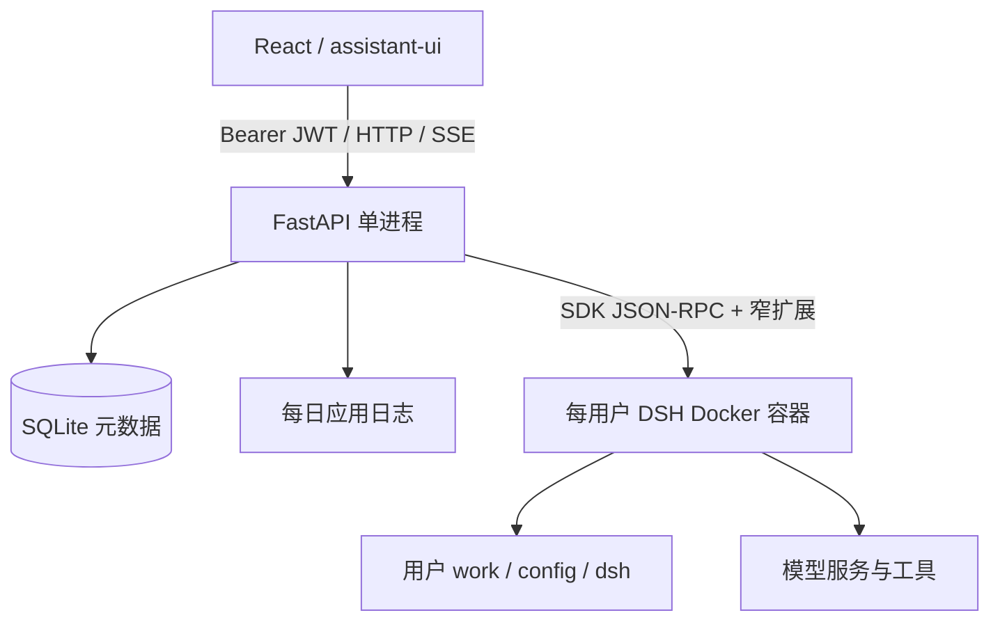

# OrchMesh v0.1：多用户 DSH 工作台

更新：2026-10-26。范围是本人和少量熟人，允许服务重启中断任务，不是企业多租户系统。引擎接入细节见 [DSH 执行层](dsh-runtime.md)。

## 系统边界

FastAPI 同时托管 Vite 构建后的网页和 API。开发时 Vite 另开热更新端口。平台负责身份、会话归属、容器生命周期、限额和 SSE；DSH 负责 Agent Loop、模型调用、工具、压缩、重试和原生事件存储。

## 身份与配置

采用官方 FastAPI 全栈模板式 OAuth2 表单登录、PyJWT 和 pwdlib。浏览器保存 Bearer token，HTTP 和 fetch SSE 都使用 Authorization；无登录 Cookie/CSRF，默认有效期 60 分钟。退出不撤销其他客户端令牌，也不取消后台执行。

管理员账号密码仅初始化一次；管理员模型地址、Key、模型名每次启动从 `.env` 同步。其他用户通过 `orchmesh configure-model` 单独配置。模型配置保留旧布局，DSH 启动器在容器内转换；不自动迁移 Pi OAuth 凭据。

## 数据与执行

SQLite 保存用户、会话归属和运行状态；按用户决定不强制 SQLite 外键约束，应用负责所有权验证。DSH 原生存储是新会话的权威来源。旧 Pi 运行时已移除，未引用的旧文件留在磁盘备份。DSH 官方 Controller 管理项目名称、成员关系、会话标题、分支、置顶和归档；SQL 仅保存账号归属、稳定目录绑定、思考偏好和运行记录。会话 ID 直接使用官方不透明字符串，取消自定义项目归档和显示分组移动。

每用户一个活动任务，全局默认四个，历史读取也占槽位。提交先记录 running，再启动后台执行。浏览器断开不取消任务；重连先发快照，256 条内存事件缓冲溢出时重发快照。

`session/wait` 等待根智能体及受管理子任务完成。停止调用 Agent.cancel，超时强制回收整个容器。完成、失败、停止均回收 Shell 子进程，保留绑定的文件与历史。副作用不回滚。容器清理失败锁定运行容量，直到修复并重启。

单实例锁防止两个 API 争用容器。服务重启清理遗留执行环境并把 running 标记 interrupted；不自动恢复未完成任务，没有独立 Worker 或持久任务队列。

## 展示、隔离与日志

TanStack Query 负责请求，Zustand 保存活动快照，assistant-ui ExternalStoreRuntime 渲染。服务端把 DSH 事件转换为既有展示消息结构，继续复用公开的 Pi message projector 作为展示适配器；它不执行 Pi Agent Loop。现有页面和工具卡片保留。

DSH SDK 的审批、提问、子智能体与请求详情尚未形成平台管理界面；不把引擎内置能力等同于已接入产品功能。

容器以宿主 UID/GID 运行，根文件系统只读，cap-drop、no-new-privileges，限制 CPU/内存/PID；只挂载本用户目录，不挂载 Docker socket 或宿主 HOME。内部工具使用自由执行模式，由外层容器隔离。仍允许出站，未实现敌对租户网络隔离。

应用使用标准 logging 按天轮转，默认保留 30 份；不记录聊天正文、模型密钥或原始 stderr。DSH 事件与应用运维日志分别存储。备份应覆盖完整 `.data/`。

## 验证边界

确定性平台测试、真实 DSH 容器与模拟模型测试、真实管理员及外部模型验收分别记录在 [实施记录](../development/implementation.md)。当前不承诺公网 HTTPS、敌对用户隔离或跨重启续跑。
