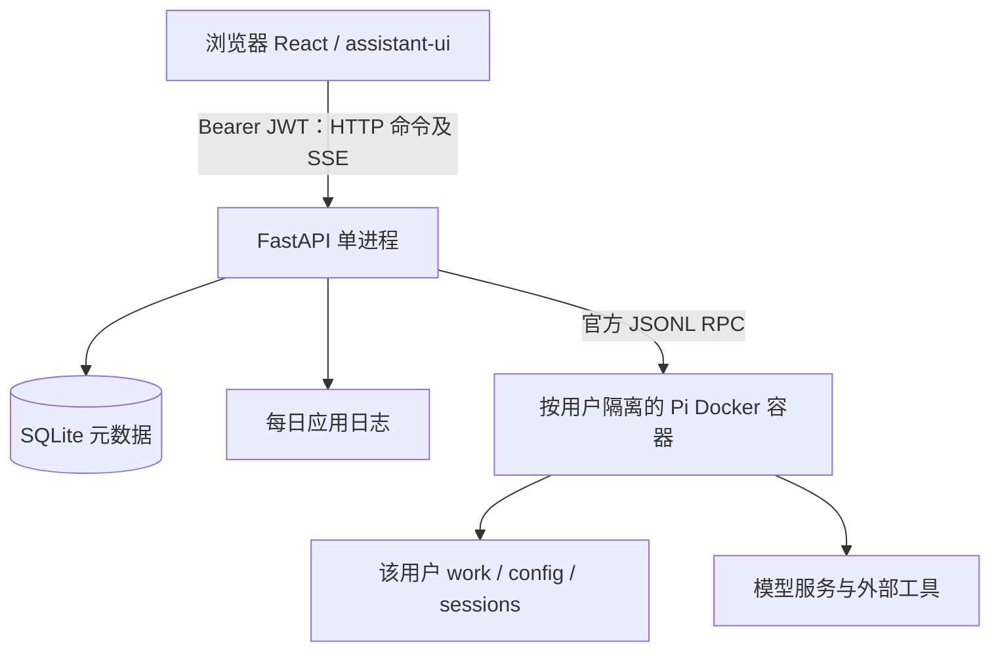

# OrchMesh v0.1：多用户 Pi 工作台架构

更新：2026-10-26。本文描述当前代码行为；目录和技术栈见 [项目结构](project-blueprint.md)。范围是本人和少量熟人，允许服务重启中断任务，不是企业多租户系统。

## 系统边界

FastAPI 同时托管构建后的前端。浏览器只访问一个生产地址；开发热更新才有 Vite 与 API 两个端口。平台拥有身份、资源归属、容器生命周期及执行限额；Pi 拥有 Agent Loop、模型请求、工具调用、压缩、重试和原生消息历史。

## 身份与配置

管理员首次从 `.env` 创建，已有账号密码不会被覆盖。其他账号通过 CLI 创建，不开放注册。管理员模型地址、Key 和模型名每次启动同步到其 Pi 配置的 `project-api` provider；不分发给其他用户。模型协议可选，默认 `openai-completions`。完整配置及移除模型的语义以 [README](../../README.md) 为准。

认证遵循 FastAPI 官方全栈模板的 Bearer JWT：表单登录获取令牌，前端保存到当前 origin 的 localStorage；普通请求及 fetch SSE 都使用 Authorization 头。没有登录 Cookie、CSRF 或数据库 token 表。默认有效期 60 分钟；流中检查过期和账号禁用。

退出清除本 origin 的令牌和 UI 缓存，同源标签页同步退出；不会撤销其他客户端的已签发 JWT，也不会停止后台任务。无自动刷新令牌或黑名单。401 才视为未登录；网络/服务器故障显示重试。

## 数据权威来源

- SQLite 的 `user` 保存身份和密码哈希；`conversation` 保存归属、标题、创建时间；`run` 保存会话关联、状态、创建时间。
- 用户 UUID 与会话 UUID 用于服务器生成的容器名称、挂载和 session 路径。
- Pi JSONL 是消息与工具记录的权威来源；平台通过 `get_messages` 读取，不维护 SQL messages 表。
- 前后端消息投影只服务活动显示与重连，不能取代原生历史。

按用户决定，不启用数据库外键约束；归属及生命周期一致性由应用处理。ORM 中的 ForeignKey 描述仍存在，不代表 SQLite 正在强制约束。当前没有请求幂等键、持久事件日志或执行完成时间字段，不承诺重发请求恰好执行一次。

## 执行生命周期

1. API 校验登录和会话归属。每用户最多一个活动运行，历史读取也占槽位；全局默认四个。运行其他会话时读取历史会拒绝，UI 同时限制切换。
2. Manager 记录 running，后台任务按需启动该用户 Pi 容器，加载对应历史，再发送 prompt。任务独立于 HTTP 请求和浏览器连接。
3. RPC 用请求 ID 关联响应，stdout 持续消费；prompt 响应表示受理。执行完成等待 `agent_settled`，不能仅凭 `agent_end` 判成功；特殊 handled disposition 不等待未启动的运行。
4. 内存保留 256 条事件。SSE 连接先发送快照，再发送增量；订阅落后超出缓冲时重新发快照。浏览器断开只断订阅，不取消执行，不承诺持久 token 重放。
5. 停止先 `clear_queue` 再 `abort`；超时取消后台任务并删除容器，清理 Shell 子进程。完成、失败和停止都回收执行容器，挂载数据保留。已有文件或外部工具副作用不会回滚。
6. 容器清理失败会锁住运行容量并提示修复；单实例文件锁避免多个 API 争用。重启清理遗留容器，把仍为 running 的记录标为 interrupted，不自动重跑。

历史读取也通过短生命周期 Pi 容器完成。平台没有常驻 Worker、Redis、任务队列或跨进程恢复执行；需要跨重启持续工作时再调整执行层。

## 展示与通信

TanStack Query 处理身份、列表、快照和 mutation；Zustand 维护当前活动消息。assistant-ui ExternalStoreRuntime 消费转换后的消息，官方 `react-pi` projector 负责工具结果、思考及文本的 UI 映射。RPC 增量适配仍由项目维护，原因见 [复用边界](project-blueprint.md#复用边界)。

浏览器使用 HTTP + SSE，Python 到 Pi 使用 stdin/stdout JSONL，Pi 到 MCP 使用其原生传输能力。未支持的附件、编辑、重新生成、分支和审批操作不在 UI 中启用；不把 Pi 具备的全部能力宣称为平台已集成。

## 隔离、日志和运维边界

整个 Pi 在容器内运行；仅挂载本用户 work/config/sessions。容器使用宿主用户 UID/GID，只读根文件系统、临时 tmpfs、cap-drop、no-new-privileges，以及内存/CPU/PID 限制；不挂载 Docker socket、宿主 HOME 或其他用户目录。

同一用户的不同对话共享文件。Shell 能读取该用户模型凭据。容器仍可出站，未建立内网访问策略；本机 Docker 不是 rootless，当前不宣称具备敌对租户沙箱能力。文件下载接口、企业权限、多租户计费和协作未实现。

应用使用标准 logging 每日轮转，默认保留 30 份归档，记录 HTTP/运行诊断但不记录聊天正文和原始 stderr。详细保留及隐私规则见 [日志说明](../development/logging.md)。它不是完整审计系统。

## 已验证与后续触发条件

截至本次实现：静态检查、29 项后端测试（含真实 Pi 容器和模拟模型）、10 项前端测试通过；真实管理员与真实模型的浏览器登录、流式回复、Shell 结果、停止、故障重试已验收。完整过程见 [实施记录](../development/implementation.md)。未验收公网部署、HTTPS、无人值守 GitHub CI 或敌对用户隔离。

出现跨机器部署/并发写入需求时评估 PostgreSQL；出现跨重启运行需求时拆独立执行服务；面向不受信任公众用户前重新设计网络和执行安全边界。当前不为这些潜在需求预建框架。
